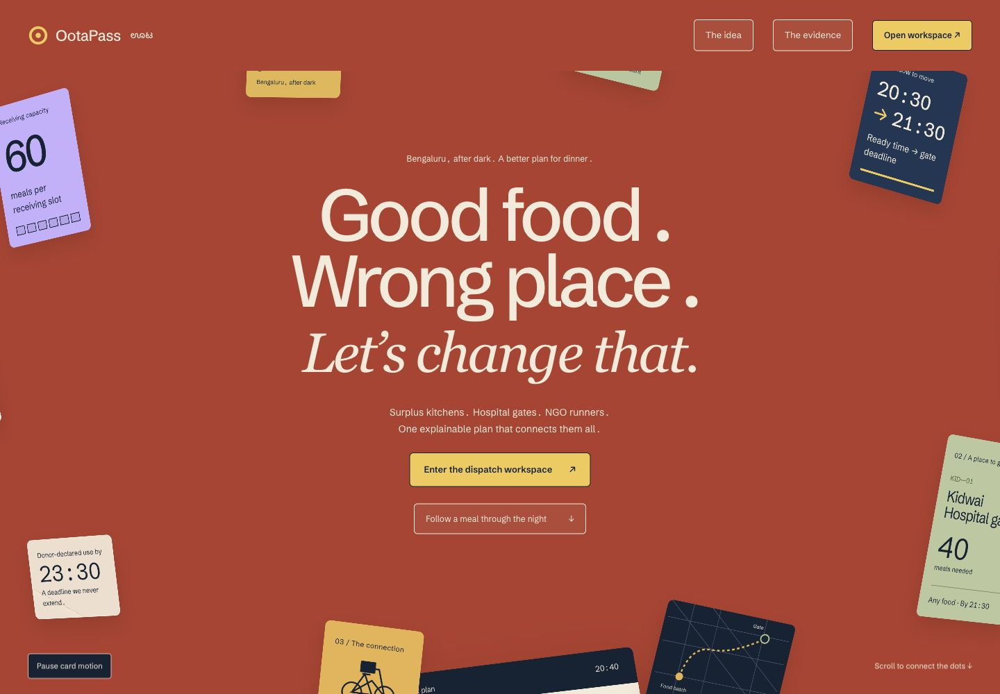
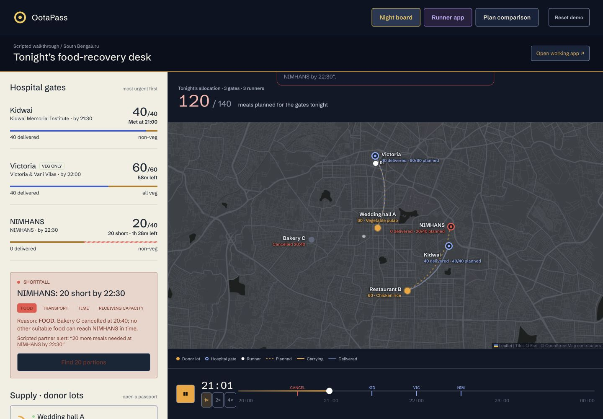
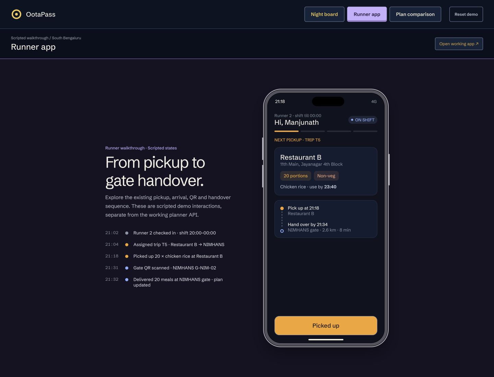

# OotaPass ಊಟ

**Plans tonight's surplus food into labelled dinners for families waiting outside Bengaluru's government hospitals, and when a gate goes short, says exactly why.**

*Oota* (ಊಟ) means meal in Kannada.

> **Team C1CORE**, BMS Institute of Technology and Management, Bengaluru · Rewired 2026 ("The Invisible City"), online round
> **All data in this prototype is synthetic.** Donor names, quantities and requests are invented for testing.

[Team repository](https://github.com/dab1704/OOTAPASS) · [Frontend fork](https://github.com/RMP2005/ootapass-ui) · [Design and verification report](docs/frontend-redesign.md)



## Explore the interface

The project has three distinct entry points. The landing introduces the problem; its **Enter the dispatch workspace** button opens the interactive demonstration. Use **Open working app** inside the demo to reach the API-backed planner.

| Screen | What you can explore |
|---|---|
| **Landing** | Ten orbiting food, gate and route cards; a scroll-led project story; food passports, shortfall explanations and sourced issue facts. Motion can be paused and respects reduced-motion preferences. |
| **Interactive console** | Top navigation for Night board, Runner app and Plan comparison. A route/replay map, cancellation example and iPhone-style runner flow. These are **scripted demonstration states**, not live delivery confirmations. |
| **Working planner** | Hospital-gate requests, surplus donations, donor/runner cancellation, replanning, map/replay, gate/trip/supply/activity views, food passports, pickup acceptance/rejection and printable QR labels. Uses the existing Flask API and SQLite storage. |



<details>
<summary>Runner phone and mobile interface</summary>



[Mobile landing](docs/frontend/ten-card-orbit-mobile.png) · [Mobile runner](docs/frontend/iphone-runner-mobile.png)

</details>

The redesign keeps the Python backend, planner rules, API contracts, persistence, tests and benchmark data unchanged. It uses the existing HTML/CSS/JavaScript stack.

---

## The problem

Every night, families of in-patients wait outside Bengaluru's government hospitals (Kidwai, Victoria & Vani Vilas, NIMHANS) with no reliable dinner. Karnataka's hospital meal scheme covers patients, not the attendants waiting at the gates. Meanwhile the city wastes an estimated ~300 tonnes of cooked food a day.

Volunteer groups already move surplus food over WhatsApp, but they work **supply first** ("I have food, who wants it?") and one message at a time. Nobody plans the whole night across every gate, and when a gate goes hungry, nobody knows why.

## Our insight

**Start from demand, plan the whole night, and explain every shortfall.**

OotaPass is a coordinator console for a registered food-recovery NGO:

1. **Gate volunteers** log roughly how many people need dinner, food preference (veg / any) and by when.
2. **Donors** (wedding halls, restaurants, bakeries, supermarkets) log their surplus and its use-by time.
3. OotaPass builds **one plan for the night**: which food goes to which gate, carried by which runner, and when.
4. When anything changes, it **re-plans from that minute**. Any gate still short gets **one clear reason**:

| Reason | Meaning |
|---|---|
| **FOOD** | Not enough suitable food can reach the gate in time |
| **TRANSPORT** | No runner is free to carry it |
| **TIME** | The trip can't arrive before the gate's deadline or the food's use-by time |
| **RECEIVING CAPACITY** | The gate can't take more right now |

---

## What it does

| Feature | Description |
|---|---|
| **One plan for the night** | Every gate request, donation and runner goes into a single plan. |
| **Shortfalls with a reason** | Each shortfall is labelled FOOD / TRANSPORT / TIME / RECEIVING CAPACITY, and the scripted console illustrates an alert such as *"20 more meals needed at NIMHANS by 22:30"*. |
| **Cancellation recovery** | When a donor or runner drops out, trips already picked up are kept and the rest of the night is re-planned. |
| **Food passport** | Each batch gets a QR label with FSSAI-style label fields, the donor's declared use-by time, and a pickup check the NGO accepts or rejects. Rejected batches are removed and the night is re-planned. |
| **Night timeline and map** | Scrub or play the night from 20:00 to 00:00 and watch runners move and deadlines approach. |
| **Honest comparison** | Every plan is compared with a simple nearest-first method on the same data. |

---

## Run locally on macOS

Needs **Python 3.10+** and Git. No Node build step is required.

```bash
# Frontend fork with the refreshed README and current UI:
git clone --branch docs/readme-refresh https://github.com/RMP2005/ootapass-ui.git
cd ootapass-ui
python3 -m venv .venv
source .venv/bin/activate
python -m pip install -r requirements.txt
python -m flask --app app run --port 5055
```

For the original team checkout, clone `https://github.com/dab1704/OOTAPASS.git`, enter `OOTAPASS`, and run the same environment and Flask commands. Existing checkouts can run those commands from the folder containing `requirements.txt`.

| Local URL | Screen |
|---|---|
| <http://127.0.0.1:5055/> | Landing and project story |
| <http://127.0.0.1:5055/console/> | Interactive **scripted demo**: Night board, Runner app, Plan comparison |
| <http://127.0.0.1:5055/?workspace=dispatch> | **API-backed planner** with working forms, cancellation and pickup checks |

To keep test data separate from your normal database:

```bash
OOTAPASS_DB=/tmp/ootapass-local-test.db python -m flask --app app run --port 5055
```

**Port 5055 already in use?** Open the existing preview if it is OotaPass, or launch with `--port 5056` and use `http://127.0.0.1:5056/`. The pip upgrade notice is unrelated to a busy port. Stop your foreground server with **Ctrl+C**.

Map tiles use OpenStreetMap / Esri and need internet. **Reset demo** restores synthetic data; use a separate test database when trying destructive demo actions. These URLs are local previews, not a public deployment.

### Quick walkthrough

1. Open the landing, explore the orbit and story, then select **Enter the dispatch workspace**.
2. In `/console/`, inspect the Night board and replay the cancellation scenario. Visit **Runner app** for its scripted pickup → arrival → QR → handover → replay flow, then **Plan comparison**.
3. Select **Open working app** for the API-backed planner. Log a gate request or surplus donation through the existing forms.
4. To reproduce the baseline cancellation example, reset the demo night, move the clock to **20:40**, and cancel **Bakery C** from the supply view. The allocation becomes **120/140 vs 100/140** for nearest-first; NIMHANS is **20 short / FOOD**.
5. Open a planned trip for its food passport, pickup checks and printable QR label.

Planned allocations and replayed movement are not confirmed real-world deliveries. Partner alerts in the console are illustrative; no external messaging integration is connected.

---

## How the planner works

The planner is about 200 lines of plain Python in [`ootapass/planner.py`](ootapass/planner.py). These are deliberately simple greedy rules that anyone on the team can explain on a whiteboard:

1. **Prioritise:** serve gate requests by deadline, most urgent first.
2. **Check feasibility:** plan a trip only if it arrives before the gate's deadline **and** the food's use-by time, within the runner's shift, the bag size (40 meals) and the gate's receiving capacity.
3. **Protect veg food:** give non-veg food to gates that accept anything, so veg food is saved for veg-only gates.
4. **Assign:** pick the trip that carries the most food; on a tie, the one with the least travel. Reserve each lot so two runners can't claim it.
5. **Explain:** label every shortfall with the first constraint that blocks it.
6. **Recover:** when a donor or runner cancels, keep trips already picked up and re-plan the rest from that minute ([`ootapass/night.py`](ootapass/night.py)).

We aim for a workable, explainable plan, not a claim of perfect optimisation. A mathematical optimiser is a possible later upgrade.

**Assumptions (not measurements):** road distance = 1.4 × straight-line distance, runners travel at 20 km/h, each handover takes 10 minutes, a bag holds 40 meals.

---

## Evidence

```bash
python -m bench.benchmark
```

On **500 random synthetic nights** (seed 2026), with both methods given exactly the same nights:

| | OotaPass | Nearest-first |
|---|---|---|
| Average share of requested meals delivered | **55.3%** | 49.2% |
| Nights with more / same / fewer meals than nearest-first | 166 / 309 / 25 | |
| Travel per delivered meal | 0.238 km | 0.240 km |

Many of these nights are deliberately short of food or runners, so neither method can reach 100%. The point is that OotaPass gets more of the available food to the gates that need it, with no extra travel. **This tests the planning logic, not real-world impact.**

## Tests

```bash
python -m unittest
```

The tests cover:
- the demo night (140/140, then 120 vs 100 after Bakery C cancels)
- trips already picked up surviving a cancellation
- veg food being saved for veg-only gates
- urgent gates going first
- food never being planned past its use-by time
- each shortfall reason being detected

---

## Tech stack

```
Gate volunteers / donors → Flask JSON API → SQLite → explainable planner → Leaflet map + QR food passport
```

- **Backend:** Python, Flask, SQLite (standard library)
- **Frontend:** HTML, CSS, JavaScript, Leaflet
- **QR labels:** `qrcode`

### API

| Method | Endpoint | Purpose |
|---|---|---|
| GET | `/api/night` | Full plan for tonight |
| POST | `/api/requests` | Add a gate request |
| POST | `/api/donations` | Add a donation |
| POST | `/api/cancel` | Cancel a donation or runner, then re-plan |
| POST | `/api/trips/<trip_id>/check` | Accept or reject a batch at pickup |
| POST | `/api/reset` | Restore the demo night |
| GET | `/api/qr/<trip_id>.svg` | QR label for a trip |
| GET | `/api/benchmark` | Benchmark results |

## Project layout

```
app.py                 Flask server, pages and JSON API
ootapass/planner.py    Planner rules, nearest-first baseline, shortfall reasons
ootapass/night.py      Replays the night and re-plans at every change
ootapass/store.py      SQLite storage
ootapass/seed.py       The synthetic demo night
templates/             Landing, API-backed planner and printable passport label
static/                Landing/planner CSS, JavaScript, shared logo, Leaflet and fonts
design/                Night console visual demo (served at /console/)
bench/benchmark.py     500-night comparison
tests/                 Unit tests
docs/                  Screenshots
```

---

## Food safety and responsibility

OotaPass records decisions; it **does not certify food as safe.**

- The **donor** is responsible for the food until handover and declares its use-by time, which OotaPass never extends.
- The **registered NGO** checks each batch at pickup (label, temperature, handling) and is responsible for safe handling until distribution, as set out in the FSSAI (Recovery and Distribution of Surplus Food) Regulations, 2019.
- Expired food, plate leftovers and batches with missing or failed checks are rejected.
- Families receive food free, with **no app and no ID needed**. Gate requests carry approximate head-counts only: no names, phone numbers or IDs.


## What's next

1. **Verify:** speak to wedding-hall managers, visit hospital gates between 9 and 11 PM, and talk to NGOs about runners, equipment and permissions.
2. **Pilot:** 30 nights with 1 NGO, 3 halls, 2 restaurants, a bakery, a supermarket and 2 gates.
3. **Measure:** portions requested vs delivered, delays, expired food and kilos rescued, and whether a small per-kg service fee is viable.
4. **Build:** connect the night console to the live API, and add a WhatsApp / Telegram bot for volunteers and donors.

---

## Declarations

- **Libraries:** [Flask](https://flask.palletsprojects.com/) (BSD-3), [qrcode](https://github.com/lincolnloop/python-qrcode) (BSD), [Leaflet 1.9.4](https://leafletjs.com/) (BSD-2, bundled in `static/vendor`)
- **Map data and tiles:** © OpenStreetMap contributors (ODbL); tiles © Esri
- **Font:** Schibsted Grotesk (SIL Open Font License, bundled)
- **AI assistance:** Claude (Anthropic) was used for original research, drafting and code assistance; the original night console in `design/` was designed with Claude Design. Codex assisted with the subsequent frontend redesign and verification.
- **Design guidance:** [Unslop](https://github.com/heydamir/unslop) by Damir Sokolovsky (CC BY 4.0) informed audit and visual refinement; [UI UX Pro Max](https://github.com/nextlevelbuilder/ui-ux-pro-max-skill) (MIT) informed responsive layout and interaction; [Open Design](https://github.com/nexu-io/open-design) (Apache 2.0) was used as a reference for hierarchy and information design. See the [full usage and attribution report](docs/frontend-redesign.md#design-repositories-and-credit).
- **Spatial inspiration:** [Cosmos](https://www.cosmos.so/) inspired the landing composition; its assets and code were not copied. OotaPass uses original food-recovery illustrations and its shared yellow ring-and-dot logo.
- **Data:** synthetic. Hospital and area locations are approximate public coordinates.
